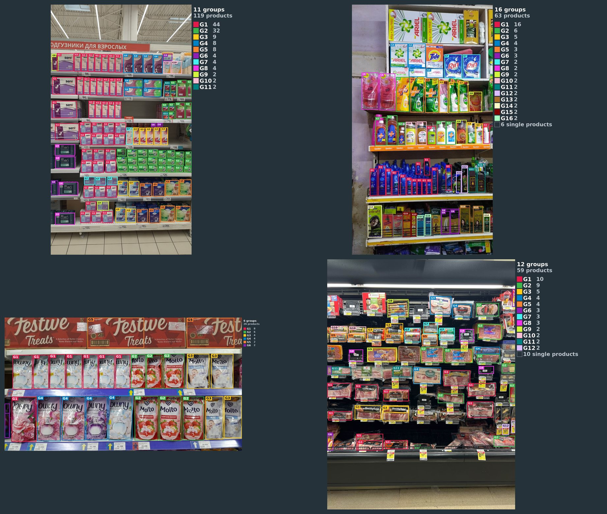
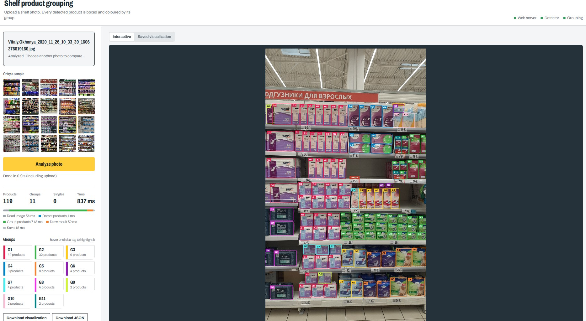
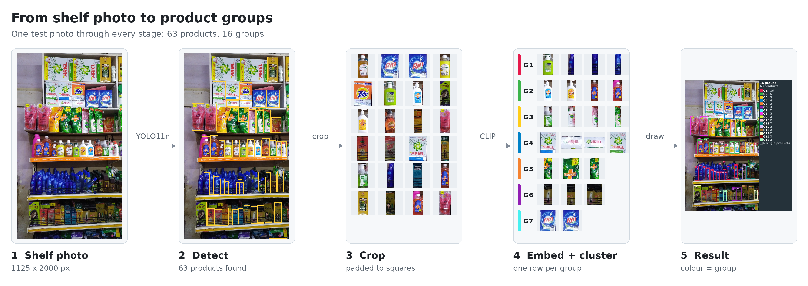
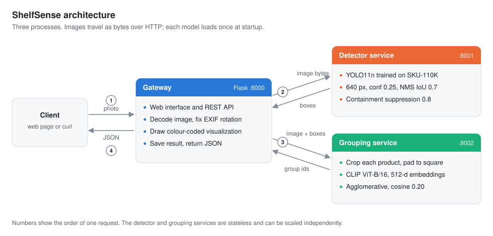
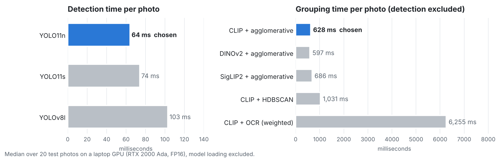
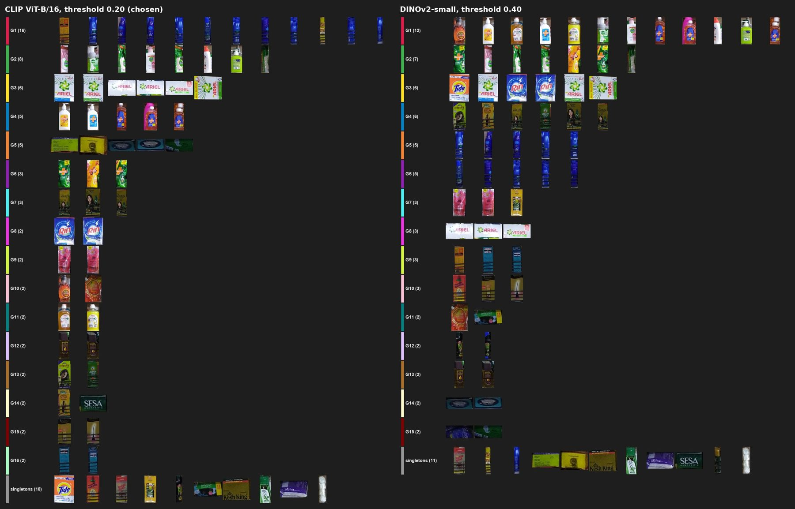

# ShelfSense

[](https://github.com/aksh1009/shelfsense/actions/workflows/tests.yml)

[](LICENSE)

Detects every product in a retail shelf photo and groups the products that belong together, with no product catalogue
and no training. Served as three Flask microservices with a web interface and a JSON API.



*Each colour is one group. Thin grey boxes are products that matched nothing else.*

## Highlights

- **Open-set grouping.** Works on products the system has never seen; the number of groups is discovered per photo.
- **Evidence-based model choice.** Six detectors, four image encoders and four clustering strategies were compared on
  the same photos for both quality and latency ([technical report](docs/REPORT.md)).
- **Fast.** YOLO11n (2.6M parameters) for detection and CLIP ViT-B/16 for grouping: about 0.8 s per photo end to end on
  a laptop GPU, of which detection is 64 ms.
- **Service architecture.** Gateway, detector and grouping run as separate processes, scale independently, and
  exchange images as bytes over HTTP.
- **Tested.** 44 unit and integration tests, run on every push; the integration tests start all three services as real
  HTTP servers.

## Demo



Upload a photo or pick a sample, then hover a group tag to highlight its products. The page also shows where the time
went per stage and offers the visualization and JSON for download.

## How it works

<picture>
  <source media="(prefers-color-scheme: dark)" srcset="assets/pipeline-dark.png">
  
</picture>

<picture>
  <source media="(prefers-color-scheme: dark)" srcset="assets/architecture-dark.svg">
  
</picture>

1. **Detect.** [YOLO11n trained on SKU-110K](https://huggingface.co/chistopat/sku110k-yolo11-object-detector) finds
   every product (confidence 0.25, NMS IoU 0.7, input 640 px).
2. **Clean up.** Containment suppression removes boxes that lie at least 80% inside a larger, higher-scoring box,
   catching the part-inside-whole duplicates (pack halves, bottle necks) that NMS misses.
3. **Embed.** Each product is cropped from the full-resolution photo, padded to a square and embedded with
   [CLIP ViT-B/16](https://huggingface.co/openai/clip-vit-base-patch16).
4. **Group.** Average-linkage agglomerative clustering on cosine distance, cut at 0.20. Groups are numbered by size.
5. **Respond.** JSON with every box, its confidence and its group id, plus a saved colour-coded visualization.

## Results

Results on the 20 test photos, produced with `scripts/run_samples.py`.

<!-- results:start -->
| Photos | Products detected | Median products per photo | Median groups per photo | Median time per photo |
| ---: | ---: | ---: | ---: | ---: |
| 20 | 1823 | 64 | 12 | 0.72 s |

Pipeline: YOLO11n (confidence 0.25, NMS IoU 0.7, containment 0.8) and CLIP ViT-B/16 embeddings with agglomerative clustering at cosine distance 0.2. Time is end to end on a laptop GPU, model loading excluded. The visualization and JSON for every photo are in [`outputs/samples/`](outputs/samples).
<!-- results:end -->

## Model selection

The full methodology, including every number below, is in the [technical report](docs/REPORT.md).

<picture>
  <source media="(prefers-color-scheme: dark)" srcset="assets/latency-dark.png">
  
</picture>

### Detector

| Model | Parameters | SKU-110K mAP50 | Detection time (GPU, median) | Outcome | Links |
| --- | --- | --- | --- | --- | --- |
| **YOLO11n** | 2.6M | 0.906 | **64 ms** | **chosen** | [Hugging Face](https://huggingface.co/chistopat/sku110k-yolo11-object-detector), [Ultralytics](https://github.com/ultralytics/ultralytics) |
| YOLO11s | 9.4M | 0.927 | 74 ms | almost the same results; slower | [Hugging Face](https://huggingface.co/chistopat/sku110k-yolo11-object-detector), [Ultralytics](https://github.com/ultralytics/ultralytics) |
| YOLOv8l | 43.7M | - | 103 ms | most complete boxes; about 3x slower on CPU | [Hugging Face](https://huggingface.co/sbfisher/yolov8l-sku110k), [Ultralytics](https://github.com/ultralytics/ultralytics) |
| YOLOv8 shelf model | - | - | - | poor box quality | [Hugging Face](https://huggingface.co/foduucom/product-detection-in-shelf-yolov8), [Ultralytics](https://github.com/ultralytics/ultralytics) |
| YOLOS-Tiny | 6.5M | - | - | capped at 100 boxes; confidence ~1.0 on everything | [Hugging Face](https://huggingface.co/Bartek7630/yolos-tiny-sku110k-refined), [YOLOS](https://github.com/hustvl/YOLOS) |
| DETR ResNet-50 | - | - | - | poor predictions | [Hugging Face](https://huggingface.co/is36e/detr-resnet-50-sku110k), [DETR](https://github.com/facebookresearch/detr) |

Detection settings were tested too: 640 px against 1280 px (the extra boxes at 1280 were duplicates and false
positives), a 4x4 sweep of confidence and NMS IoU, and containment thresholds of 0.8 and 0.9.

### Grouping

| Method | Result | Grouping time (median) | Links |
| --- | --- | --- | --- |
| **CLIP + agglomerative (0.20)** | **cleanest groups; keeps look-alike brands apart** | **628 ms** | [CLIP](https://github.com/openai/CLIP), [Hugging Face](https://huggingface.co/openai/clip-vit-base-patch16) |
| DINOv2 + agglomerative | merges different brands with similar colours | 597 ms | [DINOv2](https://github.com/facebookresearch/dinov2), [Hugging Face](https://huggingface.co/facebook/dinov2-small) |
| SigLIP2 + agglomerative | groups only near-identical products | 686 ms | [big_vision](https://github.com/google-research/big_vision), [Hugging Face](https://huggingface.co/google/siglip2-base-patch16-224) |
| CLIP + HDBSCAN | fragments product lines; unstable across photos | 1031 ms | [scikit-learn](https://github.com/scikit-learn/scikit-learn), [hdbscan](https://github.com/scikit-learn-contrib/hdbscan) |
| UMAP + HDBSCAN | merged or split known groups on synthetic data | - | [UMAP](https://github.com/lmcinnes/umap) |
| CLIP + OCR (weighted) | about 10x slower; depends on readable text | 6255 ms | [EasyOCR](https://github.com/JaidedAI/EasyOCR) |
| Colour histogram | splits one product line printed in several colours | - | [NumPy](https://github.com/numpy/numpy) |



*Same shelf, same detections; each row is one group. CLIP (left) keeps detergent brands in separate groups; DINOv2
(right) merges three of them into G3 and mixes hand-wash bottles from several brands in G1.*

## Quick start

Requires Python 3.10-3.12. An NVIDIA GPU is optional; everything also runs on CPU.

```bash
git clone https://github.com/aksh1009/shelfsense.git
cd shelfsense
python -m venv .venv
source .venv/bin/activate              # Windows: .venv\Scripts\activate

# Install PyTorch first, for your hardware:
pip install torch torchvision --index-url https://download.pytorch.org/whl/cu124   # NVIDIA GPU
# pip install torch torchvision --index-url https://download.pytorch.org/whl/cpu   # CPU only

pip install -r requirements.txt
python scripts/run_local.py
```

Open <http://localhost:8000> once it prints `Ready`. The first start downloads YOLO11n and CLIP (about 0.7 GB) into
`./models`.

> On a GPU machine, check that `python -c "import torch; print(torch.cuda.is_available())"` prints `True` after
> installing the requirements. If another package replaced PyTorch with a CPU build, reinstall it with the GPU command.

## Usage

### API

```bash
curl -F "image=@sample_images/shelf_07.jpg" http://localhost:8000/api/v1/analyze
```

```json
{
  "status": "success",
  "summary": { "num_products": 72, "num_groups": 15, "num_singletons": 12 },
  "detections": [
    { "id": 0, "bbox": { "x1": 12.5, "y1": 88.0, "x2": 301.2, "y2": 402.7 },
      "confidence": 0.8812, "group_id": "G1" }
  ],
  "groups": [ { "group_id": "G1", "num_members": 14, "color": "#e6194b", "member_ids": [0, 1, 4] } ],
  "visualization": { "url": "/api/v1/results/<request_id>/visualization.jpg" },
  "timings_ms": { "decode": 61.0, "detect": 58.3, "group": 104.4, "visualize": 38.9, "save": 12.0, "total": 274.6 }
}
```

Images can also be sent as JSON (`{"image_url": ...}` or `{"image_base64": ...}`). The detector (`POST /detect`) and
grouping (`POST /group`) services can be called directly. Every input and output format, and all error codes, are in
[docs/API.md](docs/API.md).

### Scripts

Run with the app already started, from a second terminal.

| Command | Output |
| --- | --- |
| `python scripts/run_samples.py` | a visualization and JSON per photo in `outputs/samples/` |
| `python scripts/make_readme_assets.py` | refreshes the gallery and the results table above from `outputs/samples/` |
| `python scripts/compare_methods.py` | every alternative detector and grouping method on the same photos: visualizations in `outputs/methods/<method>/` and a latency table |
| `python scripts/benchmark.py --concurrency 1 2 4` | latency and throughput under concurrent requests |
| `python scripts/figures/make_pipeline.py`, `make_architecture.py`, `make_latency_chart.py` | regenerate the README figures in `assets/` |

`python scripts/run_local.py --mode local` runs everything in one process, and
`python scripts/run_local.py --config configs/test.yaml` runs the interface with placeholder models (no downloads).

### Configuration

Every setting lives in [`configs/default.yaml`](configs/default.yaml) and can be overridden with an environment
variable, for example `SHELFAI_DEVICE=cpu` or `SHELFAI_SERVICES_GATEWAY_PORT=9000`. Switching to YOLO11s is a one-word
change of `detection.defaults.detector`.

## Project structure

```
configs/            default.yaml (all settings), test.yaml (placeholder models for tests)
shelfai/            core library; the services are thin wrappers around it
  detection/          detectors and post-processing (confidence, NMS, containment)
  grouping/           embedders (CLIP, SigLIP2, DINOv2), clustering methods, OCR
  visualization/      colour palette and rendering
  pipeline.py         detect -> group -> visualize -> save, over HTTP or in-process
  schemas.py          JSON contracts of every block
services/
  gateway/            Flask API and web interface
  detector/           detector service
  grouping/           grouping service
scripts/            run_local, run_samples, compare_methods, benchmark, make_readme_assets, download_models
  figures/            scripts that draw the README figures
tests/              unit and integration tests
docs/               REPORT.md (methodology), API.md (input and output formats)
assets/             README figures
sample_images/      test photos
outputs/samples/    visualization and JSON for every test photo
```

## Testing

```bash
pip install pytest
python -m pytest
```

The suite uses placeholder models, so it needs neither a GPU nor model downloads. It covers post-processing, every
grouping method on synthetic data with known groups, input validation and error responses, and the full request path
through all three services.

## Limitations

- Grouping is visual. One product line in very different packaging can still be split into several groups, and
  look-alike packs from different makers can occasionally share one.
- Price labels and peg hooks detected as products tend to form a group of their own.
- Group ids are per photo.
- Thresholds were chosen by inspection; a labelled evaluation set would allow precision and recall to be measured.

## Acknowledgements and licences

| Component | Licence |
| --- | --- |
| [Ultralytics YOLO](https://github.com/ultralytics/ultralytics) | AGPL-3.0 |
| [YOLO11 SKU-110K checkpoints](https://huggingface.co/chistopat/sku110k-yolo11-object-detector) | research use, following [SKU-110K](https://github.com/eg4000/SKU110K_CVPR19) terms |
| [CLIP](https://github.com/openai/CLIP) | MIT |
| [DINOv2](https://github.com/facebookresearch/dinov2), [SigLIP2](https://github.com/google-research/big_vision), [EasyOCR](https://github.com/JaidedAI/EasyOCR) | Apache-2.0 (optional alternatives) |

Model weights are downloaded at runtime and are not part of this repository. This project is released under the
[AGPL-3.0](LICENSE), as required by its use of Ultralytics YOLO.
