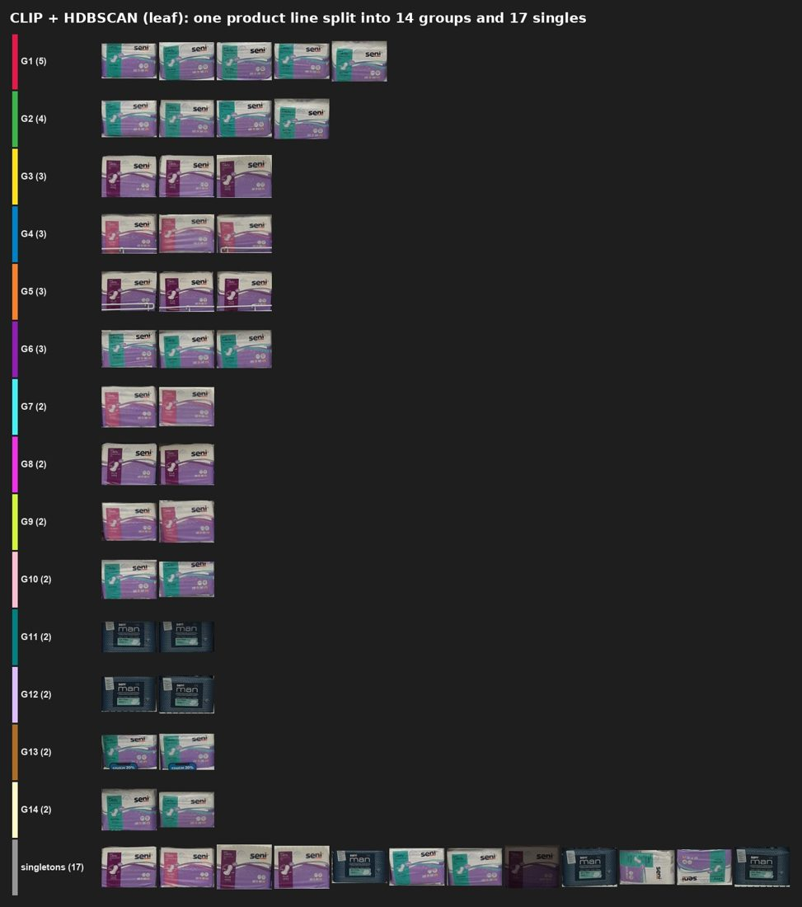

# Technical report

This document describes how the detector, the grouping method and their settings were chosen, and what else was
tried. The short version is in the [README](../README.md#model-selection).

- [Problem](#problem)
- [Detection](#detection)
- [Grouping](#grouping)
- [Alternatives evaluated](#alternatives-evaluated)
- [Latency](#latency)
- [Limitations and future work](#limitations-and-future-work)

## Problem

Input: one photo of a retail shelf. Output: a box for every product, and a group id that is shared by products that
belong together.

There is no catalogue of products to match against, so grouping must work for products the system has never seen, and
the number of groups differs in every photo. Three things make it hard:

- one product line is often printed in several colours or pack formats;
- products from different makers in the same category often look alike;
- shelves are dense (up to ~250 products per photo), with wire racks, price labels and peg hooks in the way.

All components are training-free: public pretrained checkpoints plus a small number of thresholds chosen by experiment.

## Detection

### Candidates

All candidates are public checkpoints trained on [SKU-110K](https://github.com/eg4000/SKU110K_CVPR19), a dense
retail-shelf dataset with a single class (product). None were fine-tuned.

| Model | Source | Details | Outcome |
| --- | --- | --- | --- |
| **YOLO11n** | [Hugging Face](https://huggingface.co/chistopat/sku110k-yolo11-object-detector), [Ultralytics](https://github.com/ultralytics/ultralytics) | 2.6M params; SKU-110K test mAP50 0.906, mAP50-95 0.550 | **chosen: lowest compute** |
| YOLO11s | [Hugging Face](https://huggingface.co/chistopat/sku110k-yolo11-object-detector), [Ultralytics](https://github.com/ultralytics/ultralytics) | 9.4M params; SKU-110K test mAP50 0.927, mAP50-95 0.577 | almost the same results as YOLO11n; slightly slower |
| YOLOv8l | [Hugging Face](https://huggingface.co/sbfisher/yolov8l-sku110k), [Ultralytics](https://github.com/ultralytics/ultralytics) | 43.7M params; 50 epochs at 640 | most complete boxes; about 3x slower than YOLO11s on CPU |
| YOLOv8 shelf model | [Hugging Face](https://huggingface.co/foduucom/product-detection-in-shelf-yolov8), [Ultralytics](https://github.com/ultralytics/ultralytics) | training data not documented | rejected: poor box quality |
| YOLOS-Tiny | [Hugging Face](https://huggingface.co/Bartek7630/yolos-tiny-sku110k-refined), [YOLOS](https://github.com/hustvl/YOLOS) | 6.5M params; fine-tuned 5 epochs | rejected: at most 100 boxes per photo, confidence ~1.0 on everything |
| DETR ResNet-50 | [Hugging Face](https://huggingface.co/is36e/detr-resnet-50-sku110k), [DETR](https://github.com/facebookresearch/detr) | at most 400 boxes per photo | rejected: poor predictions on the test photos |

Parameter counts are Ultralytics' published figures; the YOLO11 metrics come from the checkpoint's model card
(SKU-110K test split, 640 px).

On a laptop with an RTX 2000 Ada GPU (FP16), median detection time per photo was 39.5 ms for YOLO11s and 41.8 ms for
YOLOv8l; on the same laptop's CPU it was 172 ms and 551 ms. FP16 gave identical detections to FP32.

### Input size

640 px was compared with 1280 px. At 1280, YOLO11s returned 12% more boxes (2108 vs 1882 over 20 photos), but a
box-by-box comparison showed the extra boxes were mostly duplicates (bottle necks and pack halves boxed separately)
and false positives (empty peg hooks, price cards). The checkpoints were trained at 640; at 1280 products appear larger
than anything seen in training. 640 is used.

### Confidence and NMS

A sweep of confidence {0.15, 0.25, 0.35, 0.45} against NMS IoU {0.5, 0.6, 0.7, 0.8} (16 settings) was compared with
the 0.25 / 0.7 baseline.

- **Confidence** changed the total box count by 5-10% (2053 boxes at 0.15, 1685 at 0.45). Lower values recover partly
  hidden products but also admit more price labels and hooks; higher values remove that clutter together with real
  products.
- **NMS IoU** changed the total by only 1-2% at confidence 0.25 (1838 boxes at 0.5, 1910 at 0.8). Lower values delete
  overlapping neighbours in angled photos; higher values let near-duplicate boxes through.

No setting was clearly better, so the standard 0.25 / 0.7 is kept. Up to 1500 boxes are kept per photo; the
Ultralytics default of 300 truncates dense shelves.

### Containment suppression

NMS misses one kind of duplicate: a box around part of a product (a pack half, a bottle neck) inside the box of the
whole product. Their IoU is only about 0.5, so both survive NMS. Containment suppression removes a box when at least 80%
of its area lies inside a larger, higher-scoring box.

| Threshold | Boxes removed (of 1869) |
| --- | --- |
| 0.8 (used) | 31 |
| 0.9 | 29 |

Lower thresholds start removing real products that stand in front of larger packs.
Implementation: [`shelfai/detection/postprocess.py`](../shelfai/detection/postprocess.py).

## Grouping

### Method

1. Each detected product is cropped from the full-resolution photo and padded to a square. Padding rather than
   stretching keeps tall bottles' labels intact.
2. Each crop is embedded with [CLIP](https://github.com/openai/CLIP) ViT-B/16
   ([Hugging Face](https://huggingface.co/openai/clip-vit-base-patch16); ~86M-parameter image encoder; MIT licence).
3. Average-linkage agglomerative clustering on cosine distance repeatedly joins the two closest groups until their
   average distance exceeds 0.20. The number of groups is an output, not an input.
4. Groups are numbered by size (G1 is the largest). A product that matches nothing else becomes a group of one.

### Why CLIP

CLIP was trained on images paired with captions, so it partly reads the text printed on a pack. That pulls together
packs of one product line printed in different colours, and keeps apart look-alike packs from different makers.

[DINOv2](https://github.com/facebookresearch/dinov2)-small, trained on images alone, groups mainly by colour and
shape. On a mixed household-care shelf at threshold 0.40 it placed detergent boxes from three brands in one group
and hand-wash bottles from several brands in another; CLIP at 0.20 kept the detergent brands apart. Lowering DINOv2's
threshold (0.15 to 0.30 were tried) stopped the merging only by also splitting identical products.

*Same shelf, same detections. Each row is one group of crops. Left: CLIP at 0.20. Right: DINOv2 at 0.40, where row G3
mixes detergent packs from three makers and G1 mixes hand-wash bottles from several.*

### Threshold

CLIP was run at 0.10, 0.15 and 0.20. At 0.10 and 0.15, repeated facings of one product were split into several groups;
at 0.20 they came together while different brands stayed apart on the shelves checked. The search range came from a
histogram of each product's cosine distance to its nearest neighbour: repeated facings of one product cluster close to
zero.

## Alternatives evaluated

| Approach | Source | How it works | Result |
| --- | --- | --- | --- |
| Colour histogram | [NumPy](https://github.com/numpy/numpy) | HSV histogram per crop (8x4x4 bins, square-rooted), cosine distance | baseline only: one product line in several colours split into several groups |
| DINOv2-small | [GitHub](https://github.com/facebookresearch/dinov2), [Hugging Face](https://huggingface.co/facebook/dinov2-small) | self-supervised image model, ~21M parameters; thresholds 0.15-0.40 | merged different brands that look alike (above) |
| SigLIP2 B/16 | [GitHub](https://github.com/google-research/big_vision), [Hugging Face](https://huggingface.co/google/siglip2-base-patch16-224) | image-text model like CLIP; thresholds 0.08 and 0.12 | grouped only products that looked practically identical |
| HDBSCAN (eom and leaf) | [scikit-learn](https://github.com/scikit-learn/scikit-learn), [hdbscan](https://github.com/scikit-learn-contrib/hdbscan) | density-based; no distance threshold | poor with both selection methods (below) |
| UMAP, then HDBSCAN | [GitHub](https://github.com/lmcinnes/umap) | reduce embeddings to 10 dimensions first | on synthetic data with known groups it merged small groups or broke real ones apart; UMAP is designed for thousands of points, not 25-250 |
| OCR + visual (weighted) | [EasyOCR](https://github.com/JaidedAI/EasyOCR) | combines visual similarity with brand words read by OCR (below) | about 10x slower per request |
| Vision-language model naming brands | [Qwen3-VL](https://github.com/QwenLM/Qwen3-VL), [Hugging Face](https://huggingface.co/Qwen/Qwen3-VL-2B-Instruct) | a VLM reads each group's brand | not used: a multi-GB model generating text per group takes seconds per photo |

### HDBSCAN

HDBSCAN looks for regions that are denser than their surroundings. With only 25-250 products per photo there is little
density structure, so its output varied a lot between photos. With `leaf` selection a single product line was broken
into 14 groups and 17 singles; `eom` was closer to agglomerative clustering but inconsistent from photo to photo. Outliers
were also attached to the nearest large group with very low membership probability (0.02 in a synthetic test) and had
to be cut off explicitly.

### OCR + visual

The visual part is the score the main method already uses: the cosine similarity between two products' CLIP
embeddings. EasyOCR reads each crop, and only the largest words that are not generic packaging terms ("shampoo",
"extra", "free") are kept as brand words. For a pair of products, the text score is the share of brand words that
match. Where both products have brand words, the combined score is `(1 - w) * visual + w * text`; otherwise it is the
visual score alone. A crop with no readable text borrows the words of crops that look practically identical to it. The
combined scores then go through the same agglomerative clustering.

It was dropped for cost and fragility: OCR alone took 5.4 s per photo at the median (12.3 s at the 95th percentile),
making a request about 10x slower than CLIP alone (6.3 s vs 0.63 s). It helps only when brand text is readable, which
it often is not on small or angled products, and a single bad reading can isolate a pack in a group of its own.

All alternatives can be re-run on any set of photos with [`scripts/compare_methods.py`](../scripts/compare_methods.py).

## Latency

Measured on a laptop (RTX 2000 Ada, FP16) over the 20 test photos, about 91 products per photo. Median, with the 95th
percentile in brackets; model loading excluded.

| Detector (with CLIP grouping) | Detection | Whole request |
| --- | --- | --- |
| **YOLO11n** | **64 ms (123 ms)** | **811 ms (1603 ms)** |
| YOLO11s | 74 ms (124 ms) | 834 ms (1518 ms) |
| YOLOv8l | 103 ms (151 ms) | 884 ms (1746 ms) |

| Grouping (detection excluded) | Embedding | Clustering | Total |
| --- | --- | --- | --- |
| **CLIP + agglomerative** | **471 ms** | **3.4 ms** | **628 ms** |
| DINOv2 + agglomerative | 496 ms | 3.4 ms | 597 ms |
| SigLIP2 + agglomerative | 510 ms | 3.6 ms | 686 ms |
| CLIP + HDBSCAN | 739 ms | 7.0 ms | 1031 ms |
| CLIP + OCR weighted | 457 ms + 5425 ms OCR | 9.5 ms | 6255 ms |

Embedding the crops, not detection, dominates a request; clustering costs a few milliseconds. CLIP costs about 30 ms
more per photo than DINOv2, which its better grouping justifies.

Latency-related choices in the implementation: models load once per process with a warm-up pass; FP16 on GPU; the
detector runs at its 640 px training size; all crops of a photo are embedded in batches; the visualization is drawn on a
downscaled copy.

## Limitations and future work

- Grouping is visual: one product line in very different packaging can still land in several groups, and look-alike
  packs from different makers can occasionally share a group.
- Price labels and hooks detected as products tend to form a group of their own.
- Group ids are per photo; the same product gets different ids in different photos.
- Thresholds were chosen by inspection on 20 photos. A labelled evaluation set would allow comparing methods by
  pairwise precision (no mixing) and recall (no splitting).

Next steps: a labelled evaluation set; a product registry across photos for consistent ids; fine-tuning the image
encoder on retail data; revisiting text-based grouping once small text can be read reliably and cheaply.
